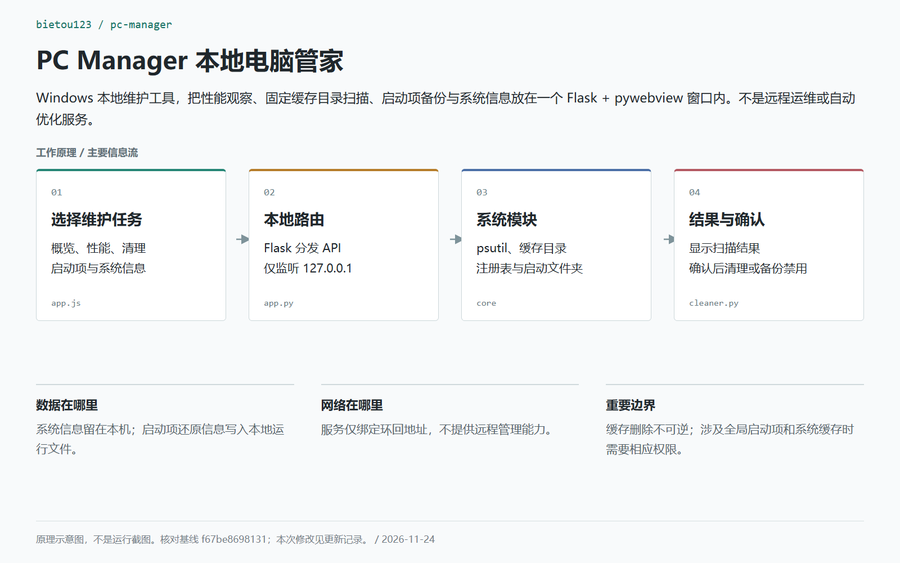

# 电脑管家 PC Manager

<!-- project-guide:start -->
## 图文原理导览

Windows 本地维护工具，把性能观察、固定缓存目录扫描、启动项备份与系统信息放在一个 Flask + pywebview 窗口内。不是远程运维或自动优化服务。



**主链路：** 选择维护任务 -> 本地路由 -> 系统模块 -> 结果与确认。

**数据与边界：** 系统信息留在本机；启动项还原信息写入本地运行文件。 服务仅绑定环回地址，不提供远程管理能力。

[完整图文说明、源码入口与运行步骤](docs/PROJECT_GUIDE.md)

<!-- project-guide:end -->

一个本地运行的 Windows 小工具：概览、实时性能、垃圾清理、启动项管理、系统信息，五个页面一个窗口搞定。Python + Flask + pywebview，界面在浏览器引擎里渲染，后端只监听 `127.0.0.1`，不联网、不上传任何数据。

## 功能

| 页面 | 内容 |
| --- | --- |
| 概览 | CPU / 内存 / 网络下行 / 开机时长四项实时指标 |
| 性能 | 每核心 CPU 占用、内存与交换分区、磁盘读写速率、网络上下行、TOP 进程、温度（Windows 通常读不到） |
| 清理 | 扫描用户临时文件、系统临时文件、Prefetch、Windows 更新缓存、崩溃转储、缩略图缓存、显卡着色器缓存、回收站；先扫描后确认，删除失败的文件跳过 |
| 启动项 | 读取注册表 Run / RunOnce（HKCU 与 HKLM）和启动文件夹；禁用时把原值备份到本地 JSON，可一键还原 |
| 系统信息 | 操作系统版本、CPU 型号与核心数、内存、磁盘、显卡、网卡 IP / MAC |

## 安全边界

- 服务只绑定 `127.0.0.1`，端口随机分配，不接受外部连接。
- 清理只处理上面列出的缓存目录，不碰文档、图片、下载等个人文件；**清理不可逆**，删除前会先扫描并展示占用空间。
- 禁用启动项不是删除：注册表值和启动文件夹里的快捷方式都会先备份，随时可以恢复。
- 清理 `C:\Windows\Temp`、Prefetch、Windows 更新缓存，以及禁用「所有用户」的启动项，需要以管理员身份运行；没有权限时对应操作会返回失败，不会静默破坏。
- 程序不上传任何数据，也没有网络请求。

## 快速开始

```powershell
pip install -r requirements.txt
python app.py
```

会打开一个 WebView2 窗口。没装 pythonnet / WebView2 时会退回默认浏览器，功能不变。

## 打包单文件 exe

```powershell
.\build.ps1
```

输出 `PCManager.exe`（约 19 MB，单文件，无控制台窗口）。`build.ps1` 保持纯 ASCII：Windows PowerShell 5.1 按 ANSI/GBK 读取无 BOM 的脚本，中文会让产物名和命令串乱码。

## 离线验证

```powershell
python tools\smoke_test.py
```

用 Flask 的 test client 直接打各接口与静态资源，不创建窗口、不启动 WebView，适合在没有桌面的环境里跑。覆盖 `/api/system`、`/api/monitor`、`/api/clean/targets`、`/api/clean/scan`、`/api/startup` 和三个静态文件。

## 目录结构

```
app.py               Flask 入口 + pywebview 窗口
core/
  cleaner.py         清理目标定义、扫描与删除
  monitor.py         实时性能采样（psutil）
  startup.py         注册表 / 启动文件夹读写与备份
  sysinfo.py         系统信息采集
web/                 纯前端页面（HTML / CSS / JS，无构建步骤）
tools/
  make_icon.py       用 Pillow 生成 app.ico
  smoke_test.py      离线接口冒烟
build.ps1            打包单文件 exe
```

## 已知限制

- 仅支持 Windows 10 / 11。
- 温度传感器在 Windows 上通常拿不到，列表为空是正常现象。
- 缩略图缓存清理后资源管理器会重建缩略图，第一次打开图片文件夹会稍慢。
- 清理 Windows 更新缓存不会取消已完成的更新，但正在下载的更新会被清掉。
- 没有做卸载残留、大文件查找、驱动管理等更重的功能，保持小而可控。

## 许可证

MIT，见 [LICENSE](LICENSE)。
