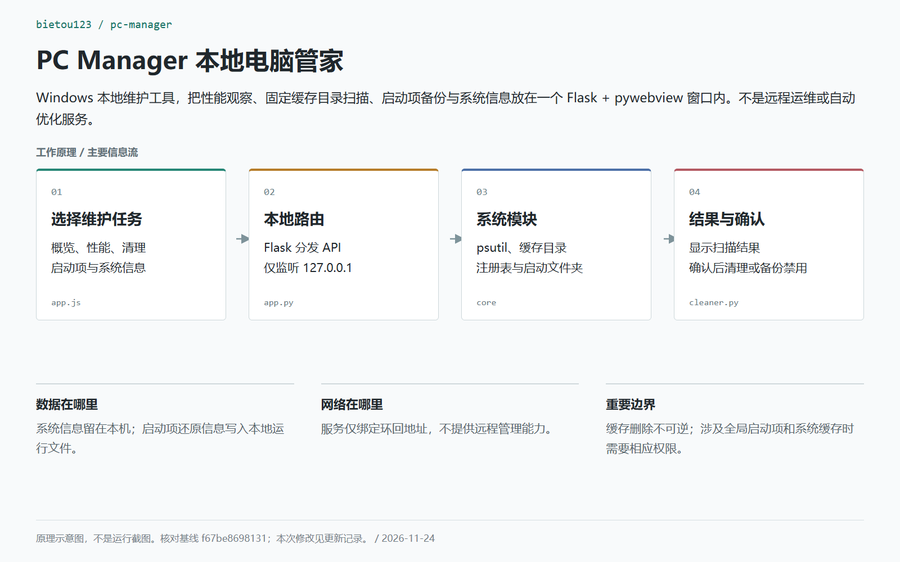

# PC Manager 本地电脑管家

Windows 本地维护工具，把性能观察、固定缓存目录扫描、启动项备份与系统信息放在一个 Flask + pywebview 窗口内。不是远程运维或自动优化服务。

**适合谁：** 需要手动检查缓存和启动项，并希望看清哪些操作只读、哪些会修改系统的 Windows 使用者。

## 一图看懂



上图是依据公开源码绘制的原理示意，不是运行截图；以下表格与文字提供相同信息，便于小屏阅读。

## 主链路与源码

| 步骤 | 做了什么 | 代码或说明入口 |
| --- | --- | --- |
| 1. 选择维护任务 | 概览、性能、清理；启动项与系统信息 | [web/app.js](../web/app.js) |
| 2. 本地路由 | Flask 分发 API；仅监听 127.0.0.1 | [app.py](../app.py) |
| 3. 系统模块 | psutil、缓存目录；注册表与启动文件夹 | [core](../core) |
| 4. 结果与确认 | 显示扫描结果；确认后清理或备份禁用 | [core/cleaner.py](../core/cleaner.py) |

## 关键原理

### 观察和修改要分开

monitor 与 sysinfo 读取系统状态；cleaner 扫描预先列出的缓存目标并执行删除。扫描得出的空间不是已经释放的空间，失败或占用中的文件可能跳过。

对应入口：[core/cleaner.py](../core/cleaner.py)。

### 启动项禁用保留还原信息

startup 模块读取 Run / RunOnce 与启动目录，禁用前记录原值或备份快捷方式。它不等于删除应用；还原依赖本地备份，因此备份文件也属于运行数据。

对应入口：[core/startup.py](../core/startup.py)。

### Web 界面是本机控制面

Flask API 与桌面 WebView 在同一台机器工作。无权限的系统级操作应失败；本地监听不意味着可以放心在浏览器粘贴外来脚本，更不能把维护端口公开。

对应入口：[app.py](../app.py)。

## 数据与安全边界

| 范围 | 说明 |
| --- | --- |
| 数据 | 系统信息留在本机；启动项还原信息写入本地运行文件。 |
| 网络 | 服务仅绑定环回地址，不提供远程管理能力。 |
| 重要边界 | 缓存删除不可逆；涉及全局启动项和系统缓存时需要相应权限。 |

## 运行与复现

pip install -r requirements.txt 后运行 python app.py。打包单文件 EXE 见 build.ps1。

在满足主 README 的依赖与前置条件后，可使用这些现有验证入口：

```text
python tools/smoke_test.py
```

命令是复现入口，不代表本次重跑了所有历史测试；本轮实测范围见更新说明。

## 已知限制

- 仅支持 Windows 10 / 11；温度传感器可能返回空。
- 不提供驱动管理、卸载残留清理或所有磁盘的大文件扫描。

## 本次更新

2026-11-24：新增项目专属原理图、源码入口、运行条件与边界说明。本项目本轮没有修改功能，也没有扩大既有实测结论。

## 可编辑流程图

下面的 Mermaid 与上方 PNG 表达同一主链路，便于后续维护：


[返回项目 README](../README.md)

源码核对基线：[f67be8698131](https://github.com/bietou123/pc-manager/tree/f67be86981319f733705964255de30a458607ac0)，并结合本次更新中列明的改动。
